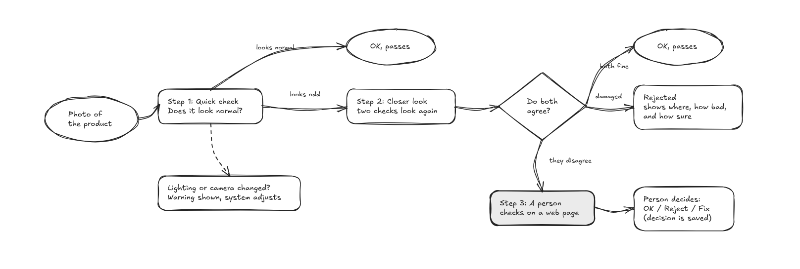

# Prometheus-X

Open-set anomaly detection for industrial images (semiconductor and PCB focus), written in Rust with [candle](https://github.com/huggingface/candle). It trains on **good images only** and flags defects it has never seen.



For every image it reports: defect or not, where (heatmap), how bad (Low / Medium / High), how sure (defect probability), a warning if lighting or camera changed, and a Good / Defect / Uncertain verdict so a person only reviews the doubtful cases. See [docs/ARCHITECTURE.md](docs/ARCHITECTURE.md).

## Run it
Needs Rust (stable). Everything below runs on the CPU.

```bash
# 1. ResNet-18 weights (once, not stored in git)
mkdir -p models
curl -L -o models/resnet18.safetensors \
  https://huggingface.co/lmz/candle-resnet/resolve/main/resnet18.safetensors

# 2. Dataset: split one VisA category (download VisA_20220922.tar from the VisA project)
./scripts/download_visa.sh pcb1 data/visa_pcb1 0.15 /path/to/VisA_20220922.tar
#    -> data/visa_pcb1/{train/good, val/good, test/good, test/defect}

# 3. Learn what "good" looks like and set the thresholds (about 5 minutes on 700 images)
cargo run --release -p cli -- build

# 4. Use it
cargo run --release -p cli -- predict data/visa_pcb1/test/defect/040.JPG
cargo run --release -p cli -- evaluate
cargo run --release -p server          # open http://127.0.0.1:8080
```

Every path, size and threshold is in [`config.toml`](config.toml). Use `--config <file>` to point the CLI at another one.

| Key | Meaning |
|---|---|
| `model_weights_path`, `input_size`, `device` | ResNet weights, resize size, `cpu` or `cuda:<n>` |
| `train_dir`, `val_dir`, `test_dir` | good training images, good validation images, test set (`good/` and `defect/`) |
| `good_vectors_path`, `patch_bank_path` | where `build` saves what it learned |
| `patch_bank_size`, `patch_seed` | how many good patches to keep, and the random seed |
| `threshold_percentile`, `uncertain_margin` | threshold from good validation scores; the relative band around it that counts as Uncertain |
| `shift_percentile` | how far from the training average counts as a lighting/camera change |
| `severity_low_max`, `severity_med_max` | edges of the Low / Medium / High severity buckets |
| `server_bind`, `max_upload_bytes`, `decisions_path` | server address, upload limit, where review decisions are saved |

## How well it works
VisA `pcb1`: 704 good for training, 150 good for validation, then 150 good and 100 defect for testing. Threshold at the 80th percentile.

| Model | Image AUROC | False-positive rate |
|---|---|---|
| Step 1, global check | 0.960 | 0.7% |
| Step 2, patch check | 0.985 | 1.3% |

Final verdicts (Step 1 passes normal images, otherwise Step 1 and Step 2 are fused):

| | Good | Uncertain | Defect |
|---|---|---|---|
| 150 good images | 136 | 14 | 0 |
| 100 defect images | 13 | 64 | 23 |

No good image is called a defect, and most defects are held for a person to review rather than passed. The 13 defects called Good are the weak spot. This was tested on one dataset only.

## Repository
`crates/` Rust workspace, `web/` the page, `scripts/` dataset split, `docs/` architecture and diagram. Team rules, code rules and how to use an AI assistant are in [CONTRIBUTING.md](CONTRIBUTING.md) and [AGENTS.md](AGENTS.md).

```bash
cargo fmt --all --check && cargo clippy --workspace --all-targets -- -D warnings && cargo test --workspace
```
