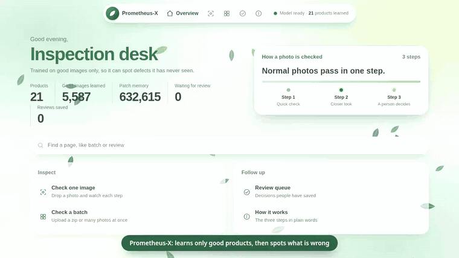
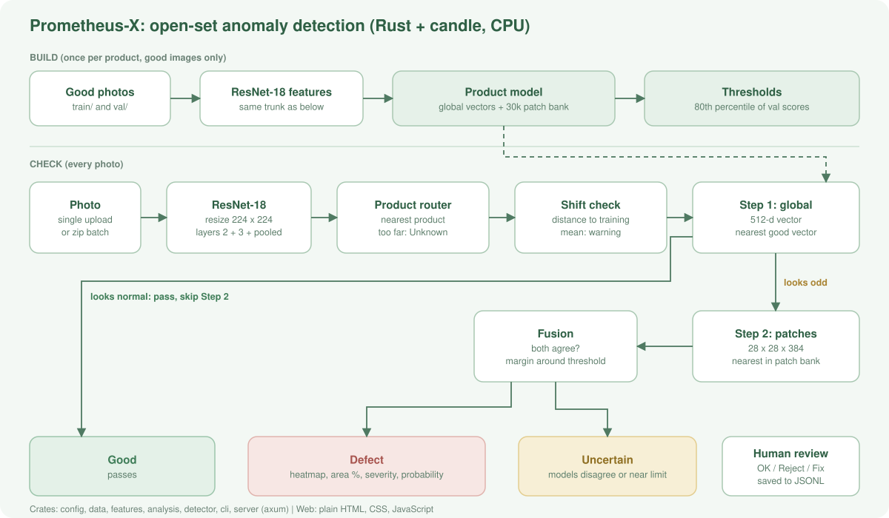

# Prometheus-X

[](docs/demo.mp4)

**[Watch the full demo video (90 s, MP4)](docs/demo.mp4).** Recorded from the running app. The single photos shown are ones the system handles correctly; measured accuracy, including where it fails, is [below](#how-well-it-works). Sample photos are from [MVTec AD](https://www.mvtec.com/company/research/datasets/mvtec-ad) (CC BY-NC-SA 4.0) and [VisA](https://github.com/amazon-science/spot-diff) (CC BY 4.0).

Open-set anomaly detection for industrial images (semiconductor and PCB focus), written in Rust with [candle](https://github.com/huggingface/candle). It trains on **good images only** and flags defects it has never seen.



For every image it reports: defect or not, where (heatmap), how bad (Low / Medium / High), how sure (defect probability), a warning if lighting or camera changed, and a Good / Defect / Uncertain verdict so a person only reviews the doubtful cases. See [docs/ARCHITECTURE.md](docs/ARCHITECTURE.md).

## Run it
Needs Rust (stable). Everything below runs on the CPU.

```bash
# 1. ResNet-18 weights (once, not stored in git)
mkdir -p models
curl -L -o models/resnet18.safetensors \
  https://huggingface.co/lmz/candle-resnet/resolve/main/resnet18.safetensors

# 2. Dataset: split one VisA category (download VisA_20220922.tar from the VisA project)
./scripts/download_visa.sh pcb1 data/visa_pcb1 0.15 /path/to/VisA_20220922.tar
#    -> data/visa_pcb1/{train/good, val/good, test/good, test/defect}

# 3. Learn what "good" looks like and set the thresholds (about 5 minutes on 700 images)
cargo run --release -p cli -- build

# 4. Use it
cargo run --release -p cli -- predict data/visa_pcb1/test/defect/040.JPG
cargo run --release -p cli -- evaluate
cargo run --release -p server          # open http://127.0.0.1:8080
cargo run --release -p cli -- robustness   # re-test on darker, brighter, blurry, colour-shifted photos
```

Every path, size and threshold is in [`config.toml`](config.toml). Use `--config <file>` to point the CLI at another one.

| Key | Meaning |
|---|---|
| `model_weights_path`, `input_size`, `device` | ResNet weights, resize size, `cpu` or `cuda:<n>` |
| `train_dir`, `val_dir`, `test_dir` | good training images, good validation images, test set (`good/` and `defect/`) |
| `good_vectors_path`, `patch_bank_path` | where `build` saves what it learned |
| `patch_bank_size`, `patch_seed` | how many good patches to keep, and the random seed |
| `threshold_percentile`, `uncertain_margin` | threshold from good validation scores; the relative band around it that counts as Uncertain |
| `shift_percentile` | how far from the training average counts as a lighting/camera change |
| `severity_low_max`, `severity_med_max` | edges of the Low / Medium / High severity buckets |
| `server_bind`, `max_upload_bytes`, `decisions_path`, `web_dir` | server address, single-image upload limit, where review decisions are saved, folder with the page files |
| `batches_dir`, `max_batch_bytes`, `max_unpacked_bytes`, `max_batch_files`, `batch_workers`, `thumb_size` | where batches are kept, upload and zip-unpack limits, file cap, images checked at once, thumbnail size |
| `products_dir`, `default_product`, `unknown_ratio` | trained products folder, name of the main model, how far a photo may be before it is unknown |
| `captures_dir`, `camera_min_frames`, `camera_val_every` | where camera frames go, the fewest frames needed, which frames are held out |
| `camera_threshold_percentile`, `camera_threshold_slack`, `camera_patch_bank_size` | how camera limits are set, and how many patches are kept |
| `camera_learn_frames`, `camera_min_spot_cells`, `camera_edge_cells` | frames recorded to learn an object, smallest live anomaly, border ignored in the live view |
| `min_mean_brightness` | images darker than this (0-255) are reported as errors, such as dataset mask files |
| `robustness_sample`, `[[perturbations]]` | images per class and the photo changes used by `robustness` |

## Several products
Each product has its own model; one ResNet is shared. Train a product by pointing a copy of `config.toml` at its `train_dir`, `val_dir`, `test_dir` and at `good_vectors_path` / `patch_bank_path` inside `models/products/<name>/`, then run `build` with `--config`. The server loads every trained folder in `products_dir`, detects the product from the photo and answers "unknown product" when a photo is more than `unknown_ratio` times the closest product's limit.

## Camera check (phone or webcam)
Teach any object by filming it, then show it a scratch or a sticker. Open the **Camera** page, start the camera, record the good object, and press *Start inspecting*. Browsers allow the camera only on `localhost`, so for an Android phone connected by USB:

```bash
adb reverse tcp:8080 tcp:8080      # the phone's localhost:8080 now reaches the PC
```

Open `http://localhost:8080/#/camera` on the phone, and on the PC press *Watch other device* to see its view and verdicts live. Use the same background and light for teaching and inspecting. Very thin scratches may be missed: each frame is checked at 224 x 224.

## The web page
Open http://127.0.0.1:8080. Six pages, in a soft white and green style with falling leaves:
- **Overview**: figures from the loaded model and links to everything.
- **Check image**: drop one photo and watch each step in a console, with the heatmap.
- **Batch**: drop a zip or many photos. A live progress bar, summary tiles (OK, needs review, defect, shift warnings, errors), a red / amber / green thumbnail grid you can filter and sort, a detail drawer with the heatmap, bulk OK / Reject / Fix, and CSV export. Results are saved under `batches_dir`, so a refresh or restart loses nothing. Old batches can be deleted from the page. Every result shows why it was flagged: how far past the limit each check was, a smooth heatmap, and numbered close-ups of the odd spots.
- **Camera**: teach an object by filming it, then inspect it live (see above).
- **Review**: every decision people saved.
- **How it works**: the diagram and the steps.

## How well it works
**Known limitation:** lighting changes are not handled well yet. On darker or brighter copies of good photos, almost all become Uncertain and the shift warning often stays silent. Re-run `prometheus-x robustness` to see it.

VisA `pcb1`: 704 good for training, 150 good for validation, then 150 good and 100 defect for testing. Threshold at the 80th percentile.

| Model | Image AUROC | False-positive rate |
|---|---|---|
| Step 1, global check | 0.960 | 0.7% |
| Step 2, patch check | 0.985 | 1.3% |

Final verdicts (Step 1 passes normal images, otherwise Step 1 and Step 2 are fused):

| | Good | Uncertain | Defect |
|---|---|---|---|
| 150 good images | 136 | 14 | 0 |
| 100 defect images | 13 | 64 | 23 |

No good image is called a defect, and most defects are held for a person to review rather than passed. The 13 defects called Good are the weak spot. These detailed counts are for `pcb1`; other products are listed below.

### Other products
The same method was trained on all MVTec AD and MVTec LOCO categories. Image AUROC of the patch check on each test set:

| Rating | Products |
|---|---|
| 0.95 and above | bottle 0.999, leather 0.997, hazelnut 0.984, wood 0.975, metal_nut 0.965, carpet 0.961 |
| 0.80 to 0.95 | toothbrush 0.90, zipper 0.89, juice_bottle 0.87, tile 0.87, capsule 0.86, transistor 0.83, screw 0.81 |
| below 0.80 | cable 0.79, splicing_connectors 0.73, pill 0.73, pushpins 0.66, screw_bag 0.65, breakfast_box 0.61, grid 0.58 |

A high AUROC does not mean good photos pass outright: leather and wood passed none, and most of their good photos went to review. Many MVTec LOCO defects are wrong counts or arrangements, which these checks are not built to catch.

## Repository
`crates/` Rust workspace, `web/` the page, `scripts/` dataset split, `docs/` architecture and diagram. Team rules, code rules and how to use an AI assistant are in [CONTRIBUTING.md](CONTRIBUTING.md) and [AGENTS.md](AGENTS.md).

```bash
cargo fmt --all --check && cargo clippy --workspace --all-targets -- -D warnings && cargo test --workspace
```
