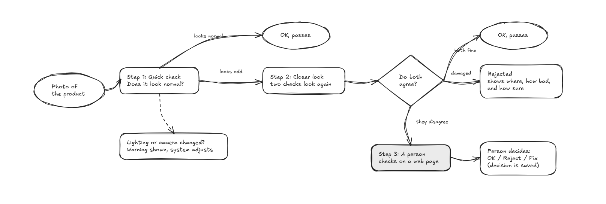

# Architecture



## Flow for one image
1. **Features.** One ResNet-18 pass (`crates/features`) gives a 512-number global vector and a grid of patch features (layer2 + layer3, 384 numbers per patch).
2. **Distribution check.** The global vector is compared with the average of the good training images. Far away means the lighting, camera or batch changed, so a warning is shown.
3. **Step 1, quick check (global model).** Score = distance to the nearest good vector. Below the threshold, the image passes and Step 2 is skipped.
4. **Step 2, closer look (patch model).** Each patch is compared with a bank of good patches. Score = the worst patch. The per-patch distances are the heatmap.
5. **Do both agree?** Both flag damage: **Defect**, with where (heatmap and area %), how bad (Low/Medium/High) and how sure (defect probability). Any disagreement or a score near its threshold: **Uncertain**.
6. **Step 3, a person decides** on the web page: OK, Reject or Fix. The decision is appended to `decisions_path` as one JSON line.

Only good images are used for training. Thresholds come from good validation images (`threshold_percentile`).

## Crates
```
config      Config struct and Config::load(path)
features    ResNet-18 trunk: image -> global vector + patch features
data        folder -> image paths / images
analysis    pure maths: threshold, evaluate (AUROC, FPR, miss), severity, calibration, shift
detector    scores, patch bank, good-vector store, verdict, fusion, predict (Step 1/2/3)
cli         prometheus-x build | predict | evaluate
server      axum: serves web/, POST /predict, POST /decision, GET /decisions, GET /status,
            POST /batch and GET /batch/{id}[/item|thumb|image|export.csv]
web/        index.html, style.css, js/ (router, pages: home, check, batch, review, how), leaves.js
```
Dependencies point one way: `config` and `data` at the bottom, then `features` and `analysis`, then `detector`, then `cli` and `server`.

## Files created at run time (not in git)
- `models/resnet18.safetensors` (downloaded once)
- `models/good_vectors.json` (global vectors, thresholds, validation scores)
- `models/patch_bank.safetensors` (good patch features)
- `data/decisions.jsonl` (human decisions)
- `data/batches/<id>/` (uploaded images, thumbnails, `results.jsonl` for each batch)

## Why ResNet features and no training
No defect is ever seen in training, so the system learns what *good* looks like and flags anything far from it. That is what lets it catch defect types it has never seen.
